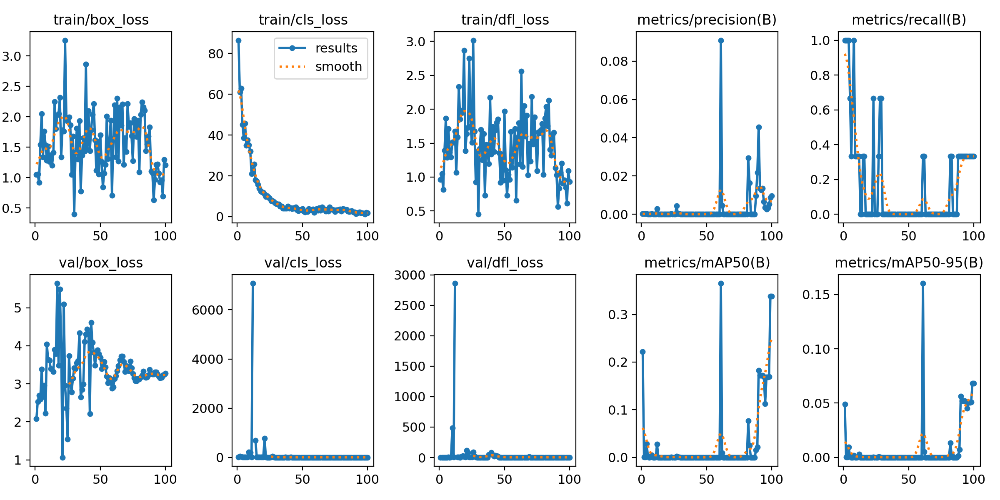
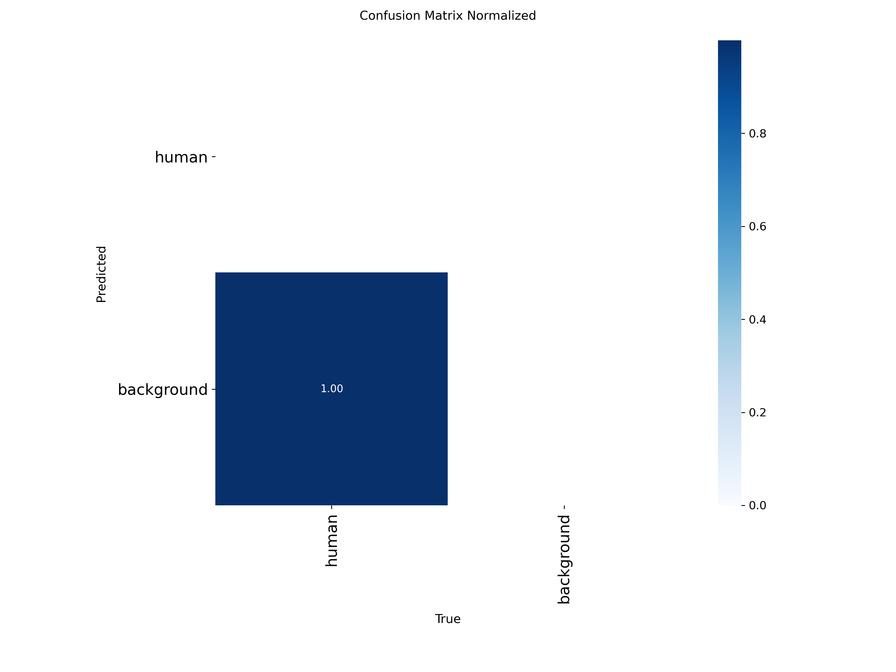

# AI Machine-Safety Interlock

> Cameras watch a production line. When a person is somewhere unsafe, the machine they are near is **stopped through the PLC** — instead of the accident only being recorded.

15 RTSP cameras, one batched YOLO pass, Modbus coils to a Delta PLC, and a zone system that knows the difference between *outside the plant wall* and *allowed to stand there*.

> **This repository is a showcase.** The source code and the camera footage belong to the client and stay private — real workers appear in the frames. Everything here is a diagram, a write-up, or an evaluation chart.

[Portfolio](https://abdurrehman629.github.io) · [All case studies](https://github.com/ABDURREHMAN629/case-studies) · [LinkedIn](https://www.linkedin.com/in/abdur-rehman-ar03247440629) · [Email](mailto:gabdurrehman493@gmail.com)

---

## The problem

People get hurt by machines in a predictable way: someone reaches in to clear a jam while the machine is running. Guards get removed, light curtains cannot tell a person from material, and CCTV only records what has already happened.

## What I built

- **15 RTSP cameras** with automatic reconnect
- All frames go through **one batched fp16 YOLOv8 pass** instead of separate inference per camera — the main reason it responds quickly
- Detections are tested against **zones** drawn for each camera
- A stop signal is sent over **Modbus** to a **Delta PLC**; two machines are controlled independently, and a third is a config entry with no code change
- A live video wall: red border = stopping a machine, amber = unhealthy camera; ignored detections are still drawn in grey with the reason, so operators always see why the system decided what it did

## Engineering problems I solved

### "Outside the wall" vs "allowed to stand here"
Some cameras see over the wall onto the road — people out there must never stop a machine. Other areas inside the plant are where operators are allowed to stand. These need opposite rules:

| Zone | Rule |
|---|---|
| **Blind** (outside the plant) | Ignored if the person's **feet** are inside it |
| **Safe** (permitted area) | Ignored only if the **whole body** is inside. One foot out and the machine stops. |

I built a mask editor so the client draws these polygons on each camera themselves.

### Cameras that move
The cameras hang on cables and shift over time. A mask that slides off its wall is dangerous both ways. Each camera keeps a reference frame, the system estimates how far it has moved, and **the masks move with it**. If it moves too far to trust, the masks switch off — making the system *more* sensitive, never less.

### Finding people without false stops
A high confidence threshold stopped machines being read as people, but also missed real people who were far, partly hidden or badly lit — the wrong trade for a safety system. I lowered the threshold and remove non-people by **shape** instead: a standing person is tall and narrow, a pipe or machine frame is not.

### Fail-safe behaviour
| Situation | Response |
|---|---|
| Camera offline for more than 30 s | Its machine is held stopped |
| Start-up | Machines start in the stopped state |
| Person briefly hidden | 4 clear frames in a row needed before "clear" |
| PLC unreachable | Loud on-screen alarm — a stop cannot be sent over a dead link, so the system never pretends it did |

### Honest model evaluation
A plant-specific model was trained to run alongside the general one. The metrics showed it had failed — the dataset had effectively **one usable labelled box** — so I **switched it off** rather than ship it, and kept the charts as the evidence for that decision.

| Training metrics (precision never leaves the floor) | Confusion matrix (every person predicted as background) |
|---|---|
|  |  |

I then built a pipeline that auto-labels recorded footage, keeps "nobody here" frames to teach the model what machines look like, and splits train/validation by source video so the score is honest.

## Technology

`Python` · `YOLOv8` · `OpenCV` · `PyTorch (fp16)` · `RTSP` · `Modbus TCP` · `Delta PLC`

---

**Need vision or automation like this?** [Email me](mailto:gabdurrehman493@gmail.com) or message me on [LinkedIn](https://www.linkedin.com/in/abdur-rehman-ar03247440629).
